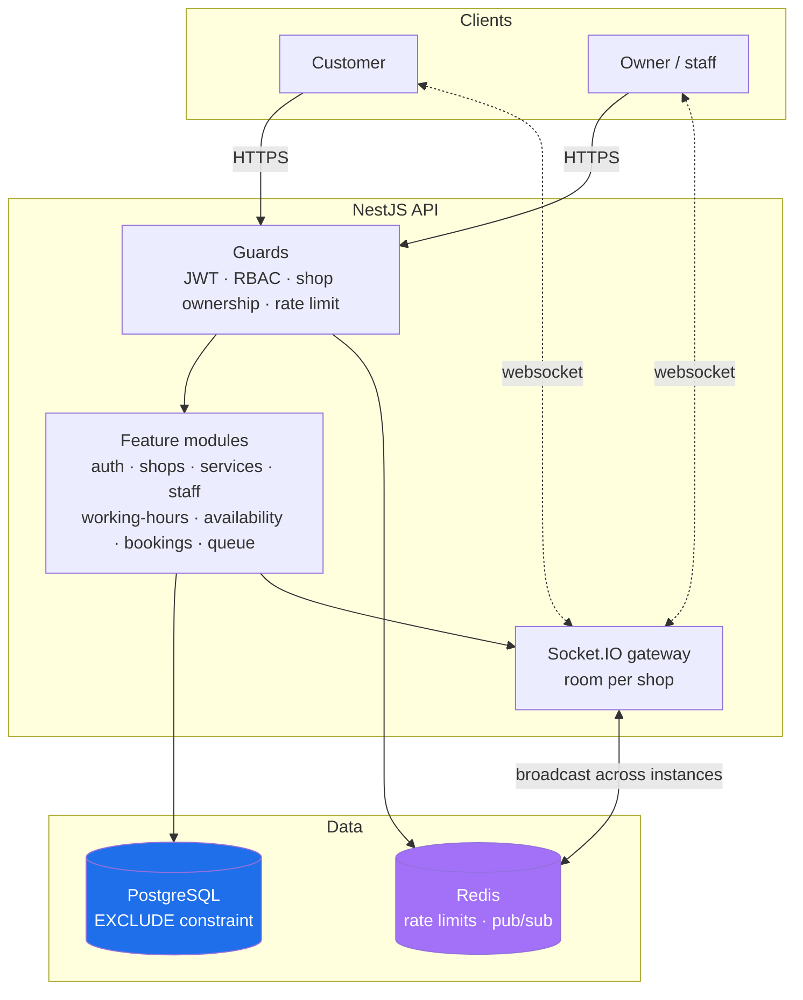
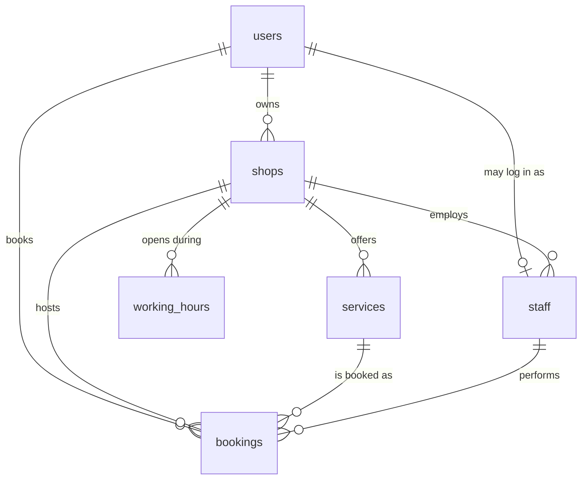

# MauApa? — Booking & Queue API

A backend for small service businesses — barbershops, salons — to take online
bookings and run a live queue, replacing the WhatsApp-and-notebook method.

It is deliberately backend-only. The interesting parts are concurrency,
multi-tenant isolation, and real-time updates; the UI is Swagger plus one small
page for watching the queue move.

**Stack** · NestJS · PostgreSQL + Prisma · Redis · JWT + RBAC · Socket.IO ·
Swagger · Jest · Docker · GitHub Actions

---

## The problem

A barbershop takes bookings over WhatsApp. Two customers message at the same
time asking for the 10:00 slot with Andi. Whoever the owner replies to first
gets it — and often both get it, because the owner is cutting hair and reads
both messages at 10:05.

Two requirements fall out of that, and they are what this project is really
about:

1. **Two simultaneous bookings for the same staff member and overlapping time
   must never both succeed.**
2. **One shop must never see or touch another shop's data.**

Everything else — slot calculation, the queue, the dashboard — is ordinary CRUD
by comparison.

---

## Architecture



Every request passes the same gauntlet before reaching a handler: authenticated
by default (routes opt *out* with `@Public()`), role-checked, and — for anything
under `/shops/:shopId` — ownership-checked.

### Data model



`shops` is the tenant boundary. Every other table hangs off it, and every query
is scoped by `shop_id`.

---

## The star: preventing double-booking

### Why application code cannot do this

The obvious implementation is check-then-insert:

```ts
const clash = await findOverlapping(staffId, start, end);   // ← A and B both run this
if (clash) throw new ConflictException();
await createBooking(...);                                    // ← A and B both run this
```

Between those two statements there is a window. Two requests arriving together
both find the slot free and both insert. Widening the transaction does not help:
the row that must not exist yet cannot be locked, so `SELECT … FOR UPDATE` has
nothing to take a lock on.

### What actually works

The rule lives in the database, as a constraint Postgres enforces on every
insert no matter how the requests interleave:

```sql
ALTER TABLE bookings
  ADD CONSTRAINT bookings_no_overlapping_per_staff
  EXCLUDE USING gist (
    staff_id WITH =,
    tstzrange(start_time, end_time, '[)') WITH &&
  )
  WHERE (status <> 'CANCELLED');
```

Read it as: *no two bookings for the same staff member may have overlapping time
ranges.*

- `EXCLUDE USING gist` compares `staff_id` with `=` and the time range with `&&`
  (overlap). The `btree_gist` extension is what lets an equality column and a
  range column share one GiST index.
- The range is `'[)'` — half-open. A booking ending at 10:00 and one starting at
  10:00 do not overlap, so back-to-back appointments stay legal.
- The `WHERE` clause makes it partial: a cancelled booking releases its slot
  instead of blocking it forever.

The application's job is only to translate the rejection into a `409`.

### Two things that only showed up by running it

**Prisma reports the violation with no structured code.** It arrives as a
`PrismaClientUnknownRequestError` whose message contains `23P01`. The detector
matches that SQLSTATE or the constraint name and *nothing else* — treating any
insert failure as "slot taken" would dress a broken database up as a polite 409.

**Conflicting inserts deadlock.** An exclusion constraint makes a conflicting
inserter *wait* on the other transaction, because whether it conflicts depends on
whether that transaction commits. Three requests racing for one slot form a wait
cycle, and Postgres kills one with `40P01`. Measured over forty rounds of three
concurrent bookings:

| | created | honest 409 | **deadlock** |
|---|---|---|---|
| Constraint alone | 40 | 20 | **60** |
| With advisory lock | 40 | 80 | **0** |
| With advisory lock, 8-way | 20 | 140 | **0** |

Three of every four losers were getting a **500**. The fix is a
transaction-scoped advisory lock keyed on the staff member, taken before the
insert, which removes the cycle — everyone queues on one lock, and different
staff still proceed in parallel.

The lock is an optimisation for *behaviour*, not the safety mechanism. It is
advisory: nothing forces a future code path to take it. **The constraint remains
the guarantee.** A bounded retry on deadlock stays as a second line of defence.

### How it is tested

`test/booking-concurrency.e2e-spec.ts` fires genuinely simultaneous requests at
one slot through the real HTTP stack against a real Postgres:

```ts
const responses = await Promise.all(customers.map((token) => bookAs(token, NINE_AM)));

expect(responses.map((r) => r.status).sort()).toEqual([201, 409, 409]);
```

Every status is asserted, not just the count of successes. That matters: a
deadlock escaping as a 500 still leaves exactly one booking behind, so a test
that only counted rows would have passed while the bug was live. It is repeated
across rounds, because a race that fails one time in ten passes once.

Covered: 2, 3 and 12 concurrent requests; overlapping-but-not-identical times;
different staff (both succeed); touching slots (both succeed); and a cancelled
booking freeing its slot.

---

## Multi-tenant isolation

Two rules, both tested with two owners and a full shop each
(`test/tenancy.e2e-spec.ts`):

**A shop you do not own answers 404, not 403.** A 403 confirms the id exists,
which hands an attacker probing ids a free oracle. To an outsider, another
tenant's shop is indistinguishable from one that was never created.

**Child lookups filter on `shop_id` *and* row id together.** A real service id
from another tenant, presented through your own shop, does not resolve — it is
invisible rather than merely forbidden.

Staff accounts are *provisioned* by an owner (email + password → a new `STAFF`
user, in one transaction) rather than linked by a client-supplied user id.
Accepting an id would let an owner attach a stranger's account.

---

## Available slots

`GET /shops/:shopId/availability?serviceId=&staffId=&date=` computes free start
times from opening hours, service duration, and existing bookings.

Opening hours are stored as **minutes from midnight**, not `TIME` columns, so
slot arithmetic is plain integer maths with no timezone ambiguity baked into the
stored value. The shop's IANA zone turns them into real instants.

That conversion is hand-rolled on `Intl` rather than pulling in a date library
for one function — and tested hard, because it is subtle. DST leaves two cases
with no single right answer:

- **Skipped** times (spring forward: 02:30 never happens) resolve *forward*, to
  the reading the clock jumped to. Resolving backward would put a slot before
  the shop opened.
- **Repeated** times (autumn fall-back: 01:30 happens twice) resolve to the
  first occurrence.

Both are tested against real 2026 US transitions, alongside a round trip of
every quarter hour across five zones and three seasons.

A closed day answers `open: false` rather than an empty list — a client cannot
otherwise tell it apart from a fully booked one.

---

## Real-time queue

```
BOOKED ──▶ WAITING ──▶ IN_PROGRESS ──▶ DONE
   │          │             │
   └──────────┴─────────────┴──▶ CANCELLED
```

`DONE` and `CANCELLED` are terminal. Owners and the shop's own staff advance a
booking; a customer can only cancel their own.

Every change broadcasts the rebuilt queue to a Socket.IO room per shop.
Positions count only the people still waiting and are assigned by walking the
waiting rows, so the person in the chair drops out of the numbering and a
cancellation leaves no gap.

Three decisions worth knowing:

- **Authentication happens in a handshake middleware**, not `handleConnection` —
  the latter runs *after* the connection is established, so a rejected client
  would still see a successful `connect`.
- **Payloads carry the date they describe.** Rooms are per shop, not per
  shop-and-date, because a date-keyed room would leave every client subscribed
  to the wrong room the moment midnight passed in the shop's zone.
- **Broadcasts go through Redis pub/sub.** Without it `server.to(room).emit()`
  reaches only clients on the same process — the feature would look fine in
  development and be quietly broken the first time the API runs two instances.

Customer names are visible only to the shop's own owner and staff. Customers see
an anonymous line with their own booking flagged, and the websocket payload —
whose audience is mixed — carries no names at all.

---

## Production concerns

**Rate limiting** counts in Redis, so the limit holds across instances rather
than per instance. The counter is a Lua script, because increment, read-TTL and
decide-if-blocked have to be one atomic step — otherwise two requests each read
`limit - 1` and both get through, which is the hole a limiter exists to close.
It fails open: losing Redis should slow nobody down.

| Route | Limit |
| --- | --- |
| `POST /auth/login`, `/auth/refresh` | 10 / minute |
| `POST /auth/register` | 5 / 10 minutes |
| `POST /shops/:id/bookings` | 20 / minute |
| everything else | 120 / minute |

**One error shape**, everywhere:

```json
{
  "statusCode": 400,
  "error": "Bad Request",
  "message": ["password must be at least 8 characters"],
  "path": "/auth/register",
  "timestamp": "2026-08-11T18:04:52.010Z"
}
```

`message` is always an array, so clients never branch on string-or-array.
Unexpected errors get a `requestId` and nothing else — a Prisma message names
tables and columns, and that belongs in the log.

**Passwords** use argon2id (19 MiB, t=2). Memory hardness is what makes GPU
cracking expensive, and there is no 72-byte input limit. Login hashes a
placeholder when the email is unknown, so response time does not disclose which
addresses are registered.

**Refresh tokens** are JWTs, but a SHA-256 hash of each is persisted so they can
be revoked — a signature alone is valid until it expires. Only the hash is
stored, so a database dump cannot be replayed. They rotate on every use, and
replaying a consumed token revokes every session for that user.

---

## Testing

```
115 unit tests   ·   156 end-to-end tests
```

End-to-end means a real Postgres and a real Redis. `configureApp()` is shared
between `main.ts` and the test suites so they cannot drift — a suite that builds
its own app with different pipes is testing something the deployment never runs.
One test asserts the published OpenAPI document, so the build fails if any
operation loses its summary or tag.

```bash
npm test           # unit
npm run test:e2e   # end-to-end (needs docker compose up -d)
```

---

## Running locally

Requires Node 20+ and Docker.

```bash
cp .env.example .env          # then set two long random JWT secrets
npm install
docker compose up -d          # Postgres 16 + Redis 7
npx prisma migrate dev
npm run start:dev
```

| | |
| --- | --- |
| Swagger | http://localhost:3000/docs |
| Queue board | http://localhost:3000/demo |
| Health | http://localhost:3000/health |

Generate secrets with:

```bash
node -e "console.log(require('crypto').randomBytes(48).toString('base64url'))"
```

### Demo data

```bash
npx ts-node prisma/seed-demo.ts
```

Creates one barbershop with services, staff, opening hours, and a queue that is
part-way through today. Logins are printed at the end; all use `demo1234`.

To watch the queue update live, open the queue board in two tabs — one as the
owner, one as a customer — and advance a booking on the owner's side.

### Running the production image

```bash
docker build -t mauapa-api .
docker run -p 3000:3000 \
  -e DATABASE_URL=... -e REDIS_URL=... \
  -e JWT_ACCESS_SECRET=... -e JWT_REFRESH_SECRET=... \
  mauapa-api
```

Migrations are applied by the entrypoint before the app accepts traffic.
`prisma migrate deploy` only applies migrations that already exist and never
generates or resets anything, so it is safe on every boot and a second instance
starting concurrently finds nothing to do.

---

## Deploying

The image is self-contained: it applies migrations and then serves. The health
check path is `/health`, which reports database connectivity rather than merely
that the process is alive.

### Railway

`railway.json` pins the Dockerfile builder and the health check.

1. **New Project → Deploy from GitHub repo.** Railway reads `railway.json` and
   builds the Dockerfile.
2. **Add a PostgreSQL and a Redis service** to the same project (`+ New` →
   Database).
3. **Set the API's variables.** The two database URLs are references, so Railway
   keeps them in step with the services:

   | Variable | Value |
   | --- | --- |
   | `DATABASE_URL` | `${{Postgres.DATABASE_URL}}` |
   | `REDIS_URL` | `${{Redis.REDIS_URL}}` |
   | `JWT_ACCESS_SECRET` | a fresh 48-byte random string |
   | `JWT_REFRESH_SECRET` | a *different* 48-byte random string |

   ```bash
   node -e "console.log(require('crypto').randomBytes(48).toString('base64url'))"
   ```

4. **Generate a domain** under Settings → Networking. Swagger is then at
   `https://<your-domain>/docs`.

Nothing else is required: `PORT` is injected by Railway, and everything in
`.env.example` beyond the four variables above already has a sensible default.

### Render

`render.yaml` provisions the web service and Postgres from the repository. Redis
is created separately — Render's managed Key Value instance — and its connection
string pasted into `REDIS_URL`. The two JWT secrets are generated by Render.

Note that Render's free web services sleep after inactivity, which drops open
websocket connections; the queue board reconnects, but a live demo will pause.

> **Public Swagger URL:** _not yet deployed._

---

## Build status

Following the phases in `plan.md`:

- [x] **Phase 0** — Setup (NestJS, Docker Compose, Prisma, Swagger, health check)
- [x] **Phase 1** — Auth + RBAC (argon2id, rotating refresh tokens, global guards)
- [x] **Phase 2** — Shops, services, staff, working hours (multi-tenant isolation)
- [x] **Phase 3** — Available slots (opening hours + duration + existing bookings)
- [x] **Phase 4** — Bookings with concurrency-safe overlap prevention
- [x] **Phase 5** — Real-time queue (Socket.IO, room per shop, Redis pub/sub)
- [x] **Phase 6** — Rate limiting, pagination, consistent errors, full Swagger
- [x] **Phase 7** — Dockerfile, CI, deployment config, this document

## Scripts

| Command | What it does |
| --- | --- |
| `npm run start:dev` | Dev server with watch mode |
| `npm run build` | Production build |
| `npm test` | Unit tests |
| `npm run test:e2e` | End-to-end tests |
| `npm run lint` | Lint (zero warnings allowed) |
| `npx prisma migrate dev` | Apply migrations |

## What I would do next

- **Booking cancellation windows.** A customer can currently cancel a booking
  one minute before it starts; a real shop wants a cutoff.
- **Notifications.** A reminder the evening before is the feature owners ask for
  first, and the queue events already exist to hang it on.
- **A read model for the queue.** It is rebuilt from scratch on every change,
  which is fine at one shop's volume and would not be at a hundred.
- **Split shifts.** `working_hours` allows one window per day, so a shop that
  closes for lunch cannot express it.
